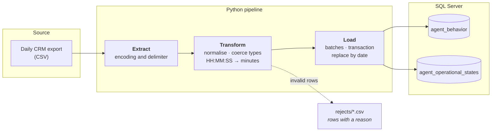

# Call centre reporting ETL to SQL Server

*[Versión en español](README.md)*

A Python ETL pipeline that takes a call centre platform's daily report, normalises it with pandas and loads it into SQL Server idempotently and in batches.

> **About this public version.** It is based on an ETL I wrote that runs in production. To publish it, the data is **synthetic** (generated by an included script) and the extraction stage — which originally automated the download from the CRM's web front end — reads the same report from a folder of CSV files instead. The transformation and loading logic is the same.

---

## The problem

Agent behaviour and operational state metrics were collected by hand every morning: log into the platform, download two reports, clean them in Excel, load them into the database. That flow had three defects:

- **It cost an hour of manual work every morning** before anyone could see a number.
- **It was brittle**: headers arrived with accents and symbols, durations came as `HH:MM:SS` text, and formats drifted between downloads.
- **It blocked everything downstream**: with no data in the database, there was no way to build dashboards or automate reporting.

## The solution

A three-stage pipeline that runs unattended and leaves the data ready to query:

- **Extract** — reads the exported report, detecting encoding and delimiter, both of which vary between exports.
- **Transform** — normalises headers (accents, `%`, spaces), converts `HH:MM:SS` durations to decimal minutes so they can be aggregated, coerces types, and **separates unusable rows into a rejects file** instead of dropping them silently.
- **Load** — batched inserts with `fast_executemany`, inside a transaction, replacing the date being processed so a rerun never duplicates data.



## Measured results

| | |
|---|---|
| Manual work removed | **1 hour every morning** |
| Report delivery | **30 minutes earlier** |
| Duplicates on rerun | **0** — the load replaces the processed date |
| Human intervention in the load | none |

## Design decisions

What separates this from a script that moves a CSV around:

**The load is idempotent.** Before inserting, the rows for the dates present in the file are deleted, all within one transaction. If the process fails midway it rolls back; if it has to be rerun, nothing is duplicated. That matters when the job runs at 6am with nobody watching.

**The table name is checked against a whitelist.** Values are bound as parameters (`?`), but a table name cannot be: it ends up interpolated into the `INSERT`. So it is verified against a fixed set of known destinations rather than escaped. ([`src/validation.py`](src/validation.py))

**Bad rows are neither lost nor fatal.** A row with no agent id is written to `rejects/` with its reason, and the rest loads. If a batch is rejected by the server, it is retried row by row to save the good rows and name the offending one.

**A missing id is never loaded as agent 0.** Required columns are validated *before* the numeric coercion that fills blanks with zero — otherwise a record with no id would enter the database as a valid agent that does not exist.

**The schema is declared once.** Each report is described in a `ReportSchema` ([`src/schemas.py`](src/schemas.py)) that all three stages read from. Adding a report means adding a schema, not touching the pipeline.

**Columns that collide with T-SQL are renamed.** The source exports columns called `In`, `Out` and `Intervalo` — all three are reserved words. They are mapped to `inbound_total`, `outbound_total` and `time_interval` rather than carrying quoted identifiers through the whole codebase.

**Retries with exponential backoff on the connection.** A network blip should not cost the day's report. (In the original project Tenacity protected the extraction stage, which does not exist here; I applied the same pattern where the real risk now sits.)

## Running it

**Requirements:** Python 3.10+. For a real load, also [Docker](https://www.docker.com/products/docker-desktop/) and the [ODBC Driver 18 for SQL Server](https://learn.microsoft.com/sql/connect/odbc/download-odbc-driver-for-sql-server).

### Without a database, in a minute

```bash
python -m venv .venv && source .venv/bin/activate    # Windows: .venv\Scripts\activate
pip install -r requirements.txt

python scripts/generate_data.py                      # generate the synthetic export
python -m src.pipeline --dry-run                     # extract and transform, no load
```

### With SQL Server

```bash
docker compose up -d                                 # wait for the healthcheck to pass
cp .env.example .env                                 # Windows: copy .env.example .env

python scripts/generate_data.py
python -m src.pipeline
```

The pipeline creates the database and the tables if they are missing, so there is nothing to set up by hand.

Here is what a second run over the same date looks like. Replaced rows equal inserted rows, which is the proof that nothing is duplicated:

```
STAGE 2: TRANSFORM
Read agent_behavior_2026-10-19.csv (26 rows, 22 columns, utf-8-sig)
WARNING - agent_behavior: 1 row(s) rejected before load
agent_behavior: 25 row(s) ready to load
Read agent_states_2026-10-19.csv (251 rows, 32 columns, utf-8-sig)
WARNING - agent_operational_states: 1 row(s) rejected before load
agent_operational_states: 250 row(s) ready to load
STAGE 3: LOAD
Database 'crm_etl_demo' already exists
Destination tables verified
  agent_behavior: 25 existing row(s) removed for 1 date(s)
  agent_behavior: 25 row(s) inserted
  agent_operational_states: 250 existing row(s) removed for 1 date(s)
  agent_operational_states: 250 row(s) inserted
CRM ETL - completed in 0.14s
  agent_behavior: 25 inserted, 25 replaced, 0 failed
  agent_operational_states: 250 inserted, 250 replaced, 0 failed
  2 row(s) rejected, see rejects/
```

The two rejected rows are the totals line each report ends with: it belongs to no agent, so it is set aside with its reason instead of loaded. To check against the database:

```sql
SELECT report_date, COUNT(*) FROM agent_behavior GROUP BY report_date;
```

### Tests

```bash
pytest
```

## Layout

```
src/
  config.py      configuration from environment variables
  schemas.py     per-report definition: mapping, types, DDL
  extract.py     reading the export (encoding, delimiter)
  transform.py   normalisation, type coercion, rejects
  validation.py  table and identifier whitelists
  db.py          connection with retries
  load.py        batched, idempotent, transactional load
  pipeline.py    orchestration
scripts/
  generate_data.py   synthetic data generator
sql/schema.sql       reference DDL
tests/               transformation and validation tests
```

## Limitations and what I would improve

- **There is no orchestrator.** In production this runs from Task Scheduler. I would move it to Airflow or Prefect to get retries, alerting and lineage without writing them by hand.
- **The destination schema is flat.** It mirrors the source report. Real analysis would want a dimensional model, with agent, campaign and date dimensions and facts split by grain.
- **The tests cover transformation, not loading.** Integration tests against the `docker-compose` SQL Server are the natural next step.
- **Validation is per row.** There are no set-level checks (totals reconciling against the source, missing-day detection), which is what actually catches a truncated report.

---

Built with AI assistance (Claude); the problem, the design decisions and the validation are mine.

**José Francisco Yudico Martínez** — Interdisciplinary professional in data science and analysis.

MIT licensed.
