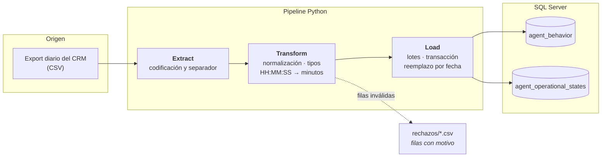

# ETL de reportes de call center a SQL Server

*[English version](README.en.md)*

Pipeline ETL en Python que toma el reporte diario de una plataforma de call center, lo normaliza con pandas y lo carga en SQL Server de forma idempotente y por lotes.

> **Sobre esta versión pública.** Está basado en un ETL que escribí y que corre en producción. Para poder publicarlo, los datos son **sintéticos** (los genera un script incluido) y la extracción, que originalmente automatizaba la descarga desde la interfaz web del CRM, aquí lee el mismo reporte desde una carpeta de archivos CSV. La lógica de transformación y de carga es la misma.

---

## El problema

Las métricas de conducta y de estados operativos de los agentes se obtenían a mano todas las mañanas: entrar a la plataforma, descargar dos reportes, limpiarlos en Excel y cargarlos a la base. El flujo tenía tres defectos:

- **Costaba una hora de trabajo manual cada mañana**, antes de que nadie pudiera ver un número.
- **Era frágil**: los encabezados venían con acentos y símbolos, las duraciones como texto `HH:MM:SS` y los formatos cambiaban entre descargas.
- **Bloqueaba todo lo demás**: sin los datos en la base, no había forma de construir tableros ni de automatizar reportes.

## La solución

Un pipeline de tres etapas que corre sin supervisión y deja los datos listos en la base:

- **Extract** — lee el reporte exportado, detectando codificación y separador, que varían entre exportaciones.
- **Transform** — normaliza encabezados (acentos, `%`, espacios), convierte duraciones `HH:MM:SS` a minutos decimales para que sean agregables, fuerza tipos y **separa las filas inservibles en un archivo de rechazos** en vez de descartarlas en silencio.
- **Load** — carga por lotes con `fast_executemany`, dentro de una transacción, reemplazando la fecha que se está procesando para que volver a correrlo nunca duplique datos.



## Resultados medidos

| | |
|---|---|
| Trabajo manual eliminado | **1 hora cada mañana** |
| Entrega del reporte | **30 minutos más temprano** |
| Duplicados por re-ejecución | **0** — la carga reemplaza la fecha procesada |
| Intervención humana en la carga | ninguna |

## Decisiones de diseño

Lo que distingue esto de un script que mueve un CSV:

**La carga es idempotente.** Antes de insertar, se borran las filas de las fechas que trae el archivo, todo dentro de una misma transacción. Si el proceso falla a media carga, se revierte; si hay que volver a correrlo, no duplica. Esto importa cuando el proceso corre a las 6 de la mañana sin nadie mirando.

**El nombre de la tabla se valida contra una whitelist.** Los valores van como parámetros (`?`), pero el nombre de la tabla no puede parametrizarse: termina interpolado en el `INSERT`. Por eso se verifica contra un conjunto fijo de destinos conocidos en vez de intentar escaparlo. ([`src/validation.py`](src/validation.py))

**Las filas malas no se pierden ni tumban la carga.** Una fila sin ID de agente se escribe a `rejects/` con el motivo, y el resto se carga. Si un lote falla en el servidor, se reintenta fila por fila para salvar las buenas e identificar la culpable.

**Un ID faltante nunca se carga como agente 0.** Las columnas obligatorias se validan *antes* de la conversión numérica que rellena vacíos con cero; si no, un registro sin ID entraría a la base como un agente válido inexistente.

**El esquema se declara una sola vez.** Cada reporte se describe en un `ReportSchema` ([`src/schemas.py`](src/schemas.py)) del que leen las tres etapas. Agregar un reporte nuevo es agregar un esquema, no tocar el pipeline.

**Las columnas que chocan con T-SQL se renombran.** El origen exporta columnas llamadas `In`, `Out` e `Intervalo`; las tres son palabras reservadas. Se mapean a `inbound_total`, `outbound_total` y `time_interval` en lugar de acarrear identificadores entrecomillados por todo el código.

**Reintentos con espera exponencial en la conexión.** Un parpadeo de red no debe costar el reporte del día. (En el proyecto original, Tenacity protegía la etapa de extracción, que aquí no existe; apliqué el mismo patrón donde ahora está el riesgo real.)

## Cómo correrlo

**Requisitos:** Python 3.10+. Para la carga real, además [Docker](https://www.docker.com/products/docker-desktop/) y el [ODBC Driver 18 para SQL Server](https://learn.microsoft.com/sql/connect/odbc/download-odbc-driver-for-sql-server).

### Sin base de datos, en un minuto

```bash
python -m venv .venv && .venv/Scripts/activate      # Linux/macOS: source .venv/bin/activate
pip install -r requirements.txt

python scripts/generate_data.py                      # genera el export sintético
python -m src.pipeline --dry-run                     # extrae y transforma, sin cargar
```

### Con SQL Server

```bash
docker compose up -d                                 # espera a que el healthcheck pase
cp .env.example .env                                 # Windows: copy .env.example .env

python scripts/generate_data.py
python -m src.pipeline
```

El pipeline crea la base y las tablas si no existen, así que no hay que preparar nada a mano.

Así se ve una segunda corrida sobre la misma fecha. Las filas reemplazadas igualan a las insertadas, que es la prueba de que no duplica:

```
STAGE 2: TRANSFORM
Read agent_behavior_2026-10-19.csv (26 rows, 22 columns, utf-8-sig)
WARNING - agent_behavior: 1 row(s) rejected before load
agent_behavior: 25 row(s) ready to load
Read agent_states_2026-10-19.csv (251 rows, 32 columns, utf-8-sig)
WARNING - agent_operational_states: 1 row(s) rejected before load
agent_operational_states: 250 row(s) ready to load
STAGE 3: LOAD
Database 'crm_etl_demo' already exists
Destination tables verified
  agent_behavior: 25 existing row(s) removed for 1 date(s)
  agent_behavior: 25 row(s) inserted
  agent_operational_states: 250 existing row(s) removed for 1 date(s)
  agent_operational_states: 250 row(s) inserted
CRM ETL - completed in 0.14s
  agent_behavior: 25 inserted, 25 replaced, 0 failed
  agent_operational_states: 250 inserted, 250 replaced, 0 failed
  2 row(s) rejected, see rejects/
```

Las dos filas rechazadas son el renglón de totales con el que termina cada reporte: no corresponde a ningún agente, así que se aparta con su motivo en vez de cargarse. Para comprobarlo contra la base:

```sql
SELECT report_date, COUNT(*) FROM agent_behavior GROUP BY report_date;
```

### Pruebas

```bash
pytest
```

## Estructura

```
src/
  config.py      configuración desde variables de entorno
  schemas.py     definición de cada reporte: mapeo, tipos, DDL
  extract.py     lectura del export (codificación, separador)
  transform.py   normalización, conversión de tipos, rechazos
  validation.py  whitelist de tablas e identificadores
  db.py          conexión con reintentos
  load.py        carga por lotes, idempotente, transaccional
  pipeline.py    orquestación
scripts/
  generate_data.py   generador de datos sintéticos
sql/schema.sql       DDL de referencia
tests/               pruebas de transformación y validación
```

## Limitaciones y qué mejoraría

- **No hay orquestador.** En producción esto corre con el Programador de tareas. Lo movería a Airflow o Prefect para tener reintentos, alertas y linaje sin escribirlos a mano.
- **El esquema de destino es plano.** Replica el reporte de origen. Para análisis real convendría un modelo dimensional, con dimensiones de agente, campaña y tiempo, y los hechos separados por grano.
- **Las pruebas cubren la transformación, no la carga.** Faltan pruebas de integración contra el SQL Server del `docker-compose`, que es el siguiente paso natural.
- **La validación es por fila.** No hay chequeos de conjunto (totales que cuadren contra el origen, detección de días faltantes), que es lo que realmente atrapa un reporte truncado.

---

Desarrollado con apoyo de IA (Claude); el problema, las decisiones de diseño y la validación son míos.

**José Francisco Yudico Martínez** — Profesional interdisciplinario en ciencia y análisis de datos.

Licencia MIT.
